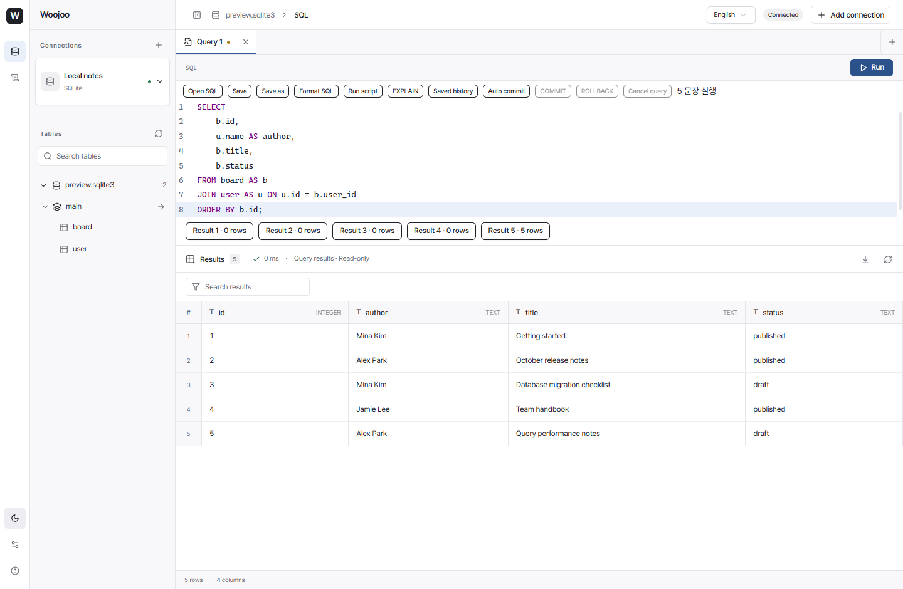
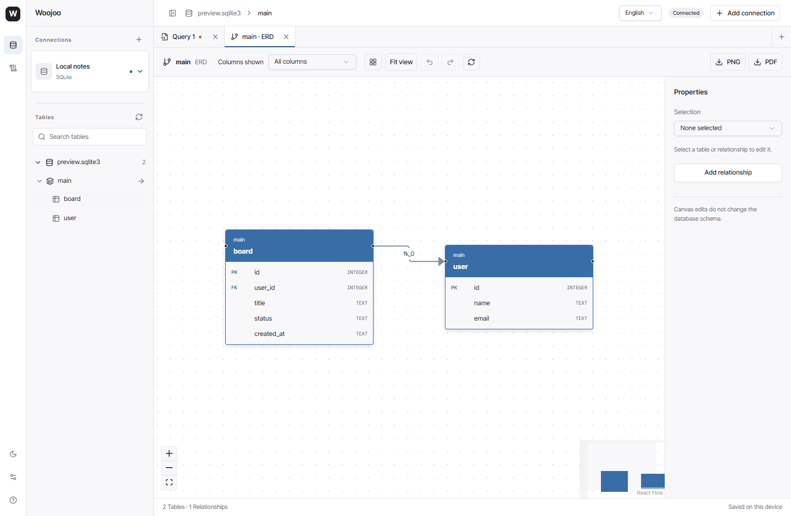

# Woojoo DB

[한국어](README.md) · **English**

A desktop database client for PostgreSQL, MySQL, MariaDB, and SQLite. Write SQL, edit data, inspect schemas, and export ER diagrams in one workspace.

[Download for Windows](https://github.com/leessang10/woojoo-db/releases/latest) · [Release notes](https://github.com/leessang10/woojoo-db/releases/tag/v0.1.0) · [Report an issue](https://github.com/leessang10/woojoo-db/issues) · [MIT license](LICENSE)



Captured from the actual Windows release using a separate SQLite database and fictional data. These records are not included on first launch. [Korean and dark mode](docs/images/workspace-ko.png) are also available.

## Features

| Area | Capabilities |
| --- | --- |
| Connections | PostgreSQL, MySQL, MariaDB, SQLite; connection testing; searchable connection switcher; saved profiles; groups, environments, and read-only settings |
| AWS RDS | Select a local AWS CLI profile, region, and RDS instance to populate connection details |
| SQL workspace | Multiple tabs, highlighting, completion, formatting, SQL files, selection and script execution, parameters, EXPLAIN |
| Sessions | Manual commit and rollback, query cancellation requests, restoration of SQL tabs and file metadata |
| Data | Search, filtering, sorting, pagination, row insertion/editing/deletion, SQL review, CSV import, CSV/JSON/SQL export, table data copying |
| Structure | Schema and table details, columns, indexes, constraints, reviewed table/column changes, engine-specific charset and collation metadata |
| ERD | Automatic PK/FK layout, table and relationship styling, PK / PK+FK / all-column modes, PNG and PDF export |
| Execution log | Executed SQL, outcomes, and duration stored in local SQLite, with search, filters, and reopening in the editor |
| Interface | Korean and English, dark and light themes, Pretendard, collapsible sidebar, context menus, keyboard navigation |



Add tables, columns, indexes, and physical foreign keys in the ERD, then use **Commit** to review SQL and apply it to the database. Drag between column handles to choose a physical FK or virtual relationship. Virtual relationships and visual styles remain diagram-only. MySQL/MariaDB DDL can partially apply because of implicit commits; the result reports completed operations.

## Installation

The current binary release targets **Windows x64**. macOS and Linux binaries are not provided.

1. Download `Woojoo-0.1.0-windows-x64.exe` from the [latest release](https://github.com/leessang10/woojoo-db/releases/latest).
2. If needed, install the WebView2 Runtime from [Microsoft](https://developer.microsoft.com/en-us/microsoft-edge/webview2/).
3. Run the EXE. No installer, Node.js, Rust, or development server is required.

The executable is not code-signed yet, so Windows may display a publisher warning. Compare its hash with the release's `SHA256SUMS.txt`:

```powershell
Get-FileHash .\Woojoo-0.1.0-windows-x64.exe -Algorithm SHA256
```

To update, close the app and replace the executable. Profiles and local data are stored in the application's user data directories, not beside the EXE. If the original v0.1.0 download shows a localhost connection error, download the corrected executable again.

## Quick start

### 1. Connect to a database

- **Server database:** Choose `Add connection`, select an engine, and enter the host, port, database, and credentials. You can also save a profile without connecting.
- **SQLite file:** Choose `Add connection → SQLite` to select or create a file.
- **First connection:** With no connections, choose the local SQLite creation action. It creates empty `user` and `board` tables with a one-to-many relationship through `board.user_id → user.id`. Existing files are reused without resetting them.
- **AWS RDS:** Authenticate with your local AWS CLI first, then choose `Add connection → AWS RDS` and select a profile, region, and instance. You still need database credentials and network access to private instances.
- **RDS TLS:** RDS hosts in commercial AWS regions automatically use the official CA bundle embedded in the app, including direct connections. Keep TLS and server certificate verification enabled. See the [CA notes](src-tauri/certs/README.md) for certificate updates and connection verification.

Right-click a connection to edit or delete its profile, disconnect, or access backup and restore. Deleting a profile does not delete its SQLite file.

### 2. Write and run SQL

Use `+` to open a query tab. `Ctrl+Enter` or `Run` executes the selection, or the editor SQL if nothing is selected. Use `Run script` for multiple statements and individual results.

For the built-in local SQLite schema, this query joins the two tables. They are initially empty, so it returns no rows until you add data.

```sql
SELECT u.id, u.name, b.title
FROM "user" AS u
LEFT JOIN board AS b ON b.user_id = u.id
ORDER BY u.id;
```

Use `Open SQL`, `Save`, and `Save as` to work with files. SQL tabs are restored after a restart; database connections must be re-established.

### 3. Browse data and structure

Click a schema or table name in the sidebar to open its details. Use the separate arrows to expand or collapse the tree. Open the table's data view and double-click an editable cell to stage a change, then review the generated SQL before applying it.

Data tools provide row insertion and deletion, server-side filters, pagination, imports, and exports. Table and column structure changes also require SQL review before application.

### 4. Use ERD and execution logs

Open the ERD from schema/table details or their context menu. Adjust positions, styles, and visible columns, then export PNG or PDF.

The executed-query page in the left navigation remains available after disconnecting. Reopening a logged query in an editor does not execute it.

### Shortcuts and preferences

| Action | Windows shortcut |
| --- | --- |
| Run SQL | `Ctrl+Enter` |
| Toggle sidebar | `Ctrl+B` |
| Open settings | `Ctrl+,` |
| Context menu | `Shift+F10` |
| Cancel a dialog | `Escape` |

Change the language in the top bar. Theme and settings controls are at the bottom of the left navigation.

## Local storage and limitations

- Connection passwords and result rows are not persisted. Profiles, connection addresses, SQL files/tabs, executed SQL, and errors are stored locally. **Literal values written into SQL are included in execution logs.**
- Execution logs are not automatically deleted. The journal records editor/script execution, EXPLAIN, object SQL, explicit transaction completion, and structure changes; it does not collect every internal grid or metadata query. Logging started with this feature and does not reconstruct older history.
- Basic table reads and free-form SQL results are capped at **500 rows**. Use data tools for larger tables. CSV imports are limited to 10,000 rows and table data copies to 100,000 rows.
- Editing requires row identity such as a primary key. Join results are read-only. MySQL/MariaDB DDL can implicitly commit changes.
- Multi-page copies and exports do not guarantee a single consistent snapshot. Pause concurrent source writes when consistency is required.
- Backup and restore may require engine-specific command-line tools on PATH: `pg_dump`/`psql`, `mysqldump`/`mysql`, or `mariadb-dump`/`mariadb`. SQLite backup is built in; restore requires the `sqlite3` CLI.
- Foreign-key value selection supports single-column keys. SQLite type/constraint changes requiring table reconstruction are not automated. PostgreSQL DDL reconstructed from metadata is not a replacement for a full `pg_dump` backup.
- Session state and transactions are not restored after restart. MySQL `DELIMITER` directives are not handled directly; use the main execution action for supported object definitions and review its confirmation.
- SSH tunnels, custom CA certificate UI, and full cross-database schema comparison/synchronization are not included. AWS discovery does not create tunnels, issue IAM database tokens, or retrieve passwords from Secrets Manager.

## Development and verification

Built with React, TypeScript, CodeMirror, shadcn/ui, Tauri 2, Rust, and SQLx.

On Windows, install Node.js 22+, Rust stable with the MSVC toolchain, Visual Studio C++ Build Tools, the Windows SDK, and WebView2. See the [Tauri prerequisites](https://v2.tauri.app/start/prerequisites/).

```powershell
git clone https://github.com/leessang10/woojoo-db.git
cd woojoo-db
npm ci
npm run desktop
```

```powershell
npm test
npm run test:ui
cargo test --manifest-path src-tauri/Cargo.toml
npm run tauri -- build --no-bundle
# Stop the development server on port 1420 before testing the EXE
npm run test:release
```

The binary is written to `src-tauri/target/release/woojoo-db.exe`. Use the Tauri CLI for distribution builds. A plain `cargo build --release` without the production protocol is deliberately rejected. UI tests use an installed Chrome browser. `npm run dev` is a browser UI preview; real database connections require the desktop app.

For v0.1.0, 32 frontend unit tests, 71 browser UI tests, and 26 Rust tests passed. Two integration tests requiring external environments are excluded by default. Some browser tests mock native database/AWS communication; these checks do not establish compatibility with every server configuration. See the [detailed reference and container test commands (Korean)](docs/REFERENCE.ko.md).

## License and credits

Woojoo source code is distributed under the **[MIT License](LICENSE)**. Third-party code and fonts retain their own licenses.

- **Pretendard Variable** — Kil Hyung-jin, **SIL Open Font License 1.1**, bundled locally. [Upstream project](https://github.com/orioncactus/pretendard) · [Copyright and full license](public/fonts/pretendard/LICENSE.txt)
- **shadcn/ui** — MIT. [Full notice](docs/licenses/shadcn-ui.txt)
- **React Flow, Dagre, html-to-image, jsPDF, and ERD dependencies** — [Third-party notices](docs/ERD-THIRD-PARTY-NOTICES.txt)
- See the [third-party license index](THIRD_PARTY_NOTICES.md) for React, CodeMirror, Radix, Lucide, Tauri, SQLx, and other components.

When [reporting an issue](https://github.com/leessang10/woojoo-db/issues), include the app version, database engine, and reproduction steps. Remove passwords, real connection addresses, and sensitive SQL before sharing.
