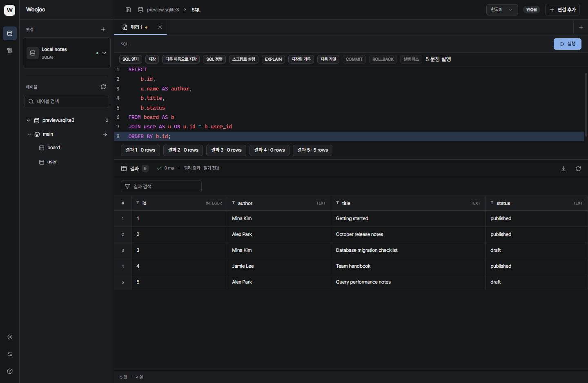
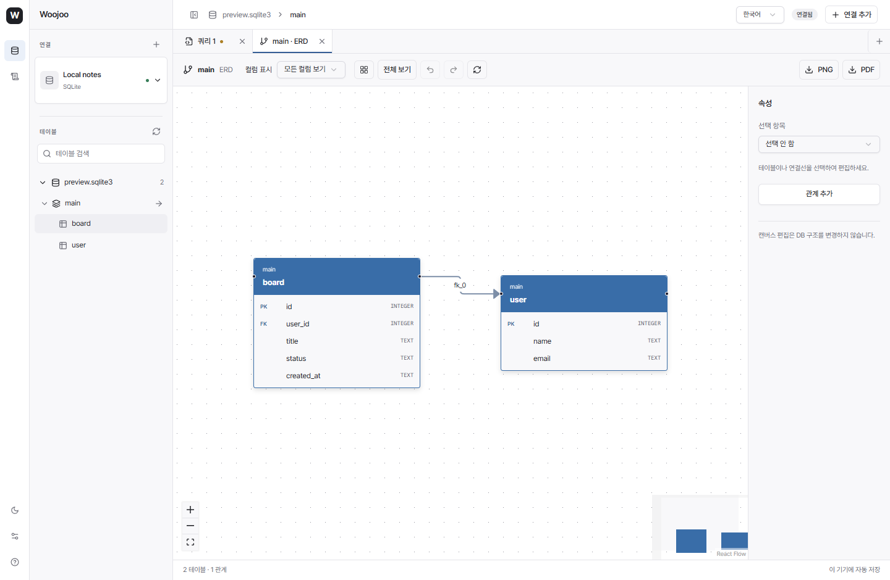

# Woojoo DB

**한국어** · [English](README.en.md)

PostgreSQL, MySQL, MariaDB, SQLite를 한 작업 공간에서 다루는 데스크톱 데이터베이스 클라이언트입니다. SQL 작성부터 데이터 편집, 스키마 탐색, ERD 내보내기까지 지원합니다.

[Windows 다운로드](https://github.com/leessang10/woojoo-db/releases/latest) · [릴리즈 노트](https://github.com/leessang10/woojoo-db/releases/tag/v0.1.1) · [문제 신고](https://github.com/leessang10/woojoo-db/issues) · [MIT 라이선스](LICENSE)



실제 Windows 배포 앱에서 별도의 SQLite와 예시 데이터로 촬영했습니다. 기본 설치에 이 데이터가 포함되지는 않습니다. [영어·라이트 모드 화면](docs/images/workspace-en.png)도 지원합니다.

## 주요 기능

| 영역 | 지원 기능 |
| --- | --- |
| 연결 관리 | PostgreSQL · MySQL · MariaDB · SQLite, 연결 테스트, 현재 연결 표시·검색 드롭다운 전환, 프로필 저장·수정·삭제, 그룹·환경·읽기 전용 설정 |
| AWS RDS | 로컬 AWS CLI의 프로필 → 리전 → RDS 인스턴스 선택으로 연결 정보 입력 |
| SQL 작업 공간 | 다중 탭, 구문 강조·자동완성·형식 정리, SQL 파일 열기·저장, 선택 SQL·스크립트 실행, 매개변수, EXPLAIN |
| 세션 | 수동 커밋·롤백, 실행 취소 요청, 연결별 SQL 탭과 파일 정보 복원 |
| 데이터 | 검색·필터·정렬·페이지 이동, 행 추가·편집·삭제, 변경 SQL 검토, CSV 가져오기, CSV/JSON/SQL 내보내기, 테이블 데이터 복사 |
| DB 구조 | 스키마·테이블 상세, 컬럼·인덱스·제약조건 조회, 테이블·컬럼 변경 SQL 검토, 엔진별 charset·collation 정보 |
| ERD | PK/FK 기반 자동 배치, 테이블·관계 스타일 편집, PK / PK+FK / 전체 컬럼 표시, PNG·PDF 내보내기 |
| 실행 내역 | 실제 실행 SQL과 성공·실패·소요 시간을 로컬 SQLite에 누적 저장, 검색·필터·다시 열기 |
| 화면 | 한국어·영어, 다크·라이트 모드, Pretendard, 접이식 사이드바, 컨텍스트 메뉴, 키보드 탐색 |



ERD에서 테이블·컬럼·인덱스와 물리 FK를 추가한 뒤 `커밋`에서 SQL을 검토하고 실제 DB에 적용할 수 있습니다. 컬럼 연결점을 드래그해 물리 FK 또는 가상 관계를 선택하세요. 가상 관계와 색상·배치 등 시각적 편집은 다이어그램에 저장됩니다. MySQL/MariaDB DDL은 암시적 커밋으로 일부 변경만 적용될 수 있으며 결과에 완료 범위가 표시됩니다.

## 설치

현재 배포 파일은 **Windows x64**용입니다. macOS·Linux용 실행 파일은 제공하지 않습니다.

1. [최신 릴리즈](https://github.com/leessang10/woojoo-db/releases/latest)에서 `Woojoo-0.1.1-windows-x64.exe`를 다운로드합니다.
2. WebView2 런타임이 없다면 [Microsoft 공식 다운로드](https://developer.microsoft.com/en-us/microsoft-edge/webview2/)에서 설치합니다.
3. EXE를 실행합니다. 별도 설치 프로그램이나 Node.js, Rust, 개발 서버가 필요하지 않습니다.

EXE는 아직 코드 서명되지 않았습니다. Windows에서 게시자 경고가 표시될 수 있습니다. 다운로드한 파일은 릴리즈의 `SHA256SUMS.txt`와 비교할 수 있습니다.

```powershell
Get-FileHash .\Woojoo-0.1.1-windows-x64.exe -Algorithm SHA256
```

업데이트할 때는 앱을 종료하고 새 EXE로 교체합니다. 연결 프로필과 로컬 데이터는 EXE 옆이 아닌 앱의 사용자 데이터 영역에 저장됩니다. 최초 v0.1.0에서 localhost 연결 오류가 발생했다면 수정된 EXE를 다시 다운로드하세요.

## 빠른 시작

### 1. 데이터베이스 연결

- **서버 DB:** `연결 추가`에서 엔진과 주소·포트·DB·계정 정보를 입력하고 연결합니다. 프로필만 저장할 수도 있습니다.
- **SQLite 파일:** `연결 추가 → SQLite`에서 파일을 선택하거나 생성합니다.
- **처음 사용하기:** 연결이 없는 화면에서 `로컬 SQLite 만들기`를 누릅니다. 빈 `user`, `board` 테이블과 `board.user_id → user.id`의 1:N 관계를 만듭니다. 기존 파일은 초기화하지 않습니다.
- **AWS RDS:** 로컬 AWS CLI에서 먼저 로그인한 뒤 `연결 추가 → AWS RDS`에서 프로필·리전·인스턴스를 선택합니다. DB 비밀번호와 사설망 접근 환경은 별도로 필요합니다.
- **비밀번호 기억:** 연결 창에서 `이 PC에 비밀번호 기억`을 선택하면 연결 성공 후 안전하게 저장하고, 다음 실행 시 마지막 연결에 자동 접속합니다. `저장된 비밀번호 삭제`로 지울 수 있으며 호스트·포트·사용자·DB·엔진·TLS 설정이 바뀌면 다시 입력해야 합니다.
- **RDS TLS:** 상용 AWS 리전의 RDS 호스트에는 앱에 포함된 공식 CA 인증서를 자동 적용합니다. 직접 연결에서도 `TLS 사용 · 서버 인증서 검증`을 켠 채 연결할 수 있습니다. 인증서 갱신 및 접속 검증 방법은 [CA 안내](src-tauri/certs/README.md)를 참고하세요.

연결을 우클릭하면 프로필 수정·삭제, 연결 끊기, 백업·복원 메뉴를 사용할 수 있습니다. 프로필 삭제는 SQLite 파일을 삭제하지 않습니다.

### 2. SQL 작성과 실행

`+`로 새 쿼리 탭을 열고 SQL을 입력합니다. `Ctrl+Enter` 또는 `실행`을 누르면 선택한 SQL을 실행하며, 선택 영역이 없으면 편집기 SQL을 실행합니다. 여러 문장의 개별 결과는 `스크립트 실행`으로 확인합니다.

처음 만든 로컬 DB에서는 다음 SQL로 두 테이블의 관계를 조회할 수 있습니다. 테이블은 비어 있으므로 행을 추가하기 전에는 결과가 없습니다.

```sql
SELECT u.id, u.name, b.title
FROM "user" AS u
LEFT JOIN board AS b ON b.user_id = u.id
ORDER BY u.id;
```

`SQL 열기`, `저장`, `다른 이름으로 저장`으로 파일을 관리합니다. 재시작하면 SQL 탭을 복원하며, 실제 DB에는 다시 연결해야 합니다.

### 3. 데이터와 구조 탐색

사이드바의 스키마·테이블 이름을 클릭하면 상세 화면이 열립니다. 펼치기·접기는 별도 화살표로 조작합니다. 테이블 상세의 `데이터 보기`에서 데이터를 조회하고, 편집 가능한 셀을 더블클릭해 변경을 대기열에 넣습니다. 변경 SQL을 검토한 뒤 적용합니다.

`데이터 도구`에서는 행 추가·삭제, 서버 필터와 페이지 이동, 가져오기·내보내기를 사용할 수 있습니다. 테이블·컬럼 구조 변경도 적용 전 SQL을 검토합니다.

### 4. ERD와 실행 내역

스키마·테이블 상세 또는 우클릭 메뉴의 `ERD 열기`로 관계도를 엽니다. 테이블 위치와 스타일, 컬럼 표시를 조정하고 PNG/PDF로 내보낼 수 있습니다.

왼쪽 도구 모음의 `실행한 쿼리`는 연결이 끊긴 뒤에도 실행 내역을 보여줍니다. SQL을 편집기로 다시 여는 동작은 SQL을 즉시 실행하지 않습니다.

### 단축키와 설정

| 동작 | Windows 단축키 |
| --- | --- |
| SQL 실행 | `Ctrl+Enter` |
| 사이드바 접기·펴기 | `Ctrl+B` |
| 설정 열기 | `Ctrl+,` |
| 컨텍스트 메뉴 | `Shift+F10` |
| 대화상자 취소 | `Escape` |

상단 언어 선택에서 한국어·영어를 전환하고, 왼쪽 하단에서 테마와 설정을 변경합니다.

## 저장되는 정보와 현재 제한

- 연결 비밀번호는 선택 시 Windows 자격 증명 관리자에 암호화하여 저장하며, 프로필 파일에는 포함하지 않습니다. 저장을 선택하지 않으면 앱 종료 전까지만 메모리에서 기억합니다. 결과 행은 저장하지 않습니다. 연결 주소·프로필, SQL 파일·탭, 실행 SQL과 오류는 로컬에 저장됩니다. **SQL 본문에 쓴 값도 실행 내역에 포함됩니다.**
- 실행 내역은 자동 삭제하지 않습니다. 데이터 그리드 내부 조회 등 모든 내부 SQL을 수집하는 기능은 아닙니다. 자세한 범위는 [기능 참고 문서](docs/REFERENCE.ko.md)를 확인하세요.
- 기본 조회와 자유 SQL 결과는 최대 **500행**입니다. 큰 테이블에는 데이터 도구를 사용하세요. CSV 가져오기는 10,000행, 테이블 데이터 복사는 100,000행까지입니다.
- 데이터 편집에는 기본키 등 식별 정보가 필요합니다. 조인 결과는 읽기 전용입니다. MySQL/MariaDB의 DDL은 암묵적으로 커밋될 수 있습니다.
- 백업·복원에는 엔진별 외부 CLI가 필요할 수 있습니다. SQLite 백업은 내장 기능이며 복원에는 `sqlite3` CLI가 필요합니다.
- SSH 터널, 사용자 지정 CA 인증서 UI, 전체 DB 간 구조 비교·동기화는 아직 지원하지 않습니다. 자동 테스트가 모든 서버 설정의 호환성을 보장하지는 않습니다.

## 개발 및 검증

React · TypeScript · CodeMirror · shadcn/ui · Tauri 2 · Rust/SQLx로 구성되어 있습니다.

Windows에서 Node.js 22+, Rust stable MSVC, Visual Studio C++ Build Tools와 Windows SDK, WebView2를 준비하세요. [Tauri 개발 환경 안내](https://v2.tauri.app/start/prerequisites/)를 참고할 수 있습니다.

```powershell
git clone https://github.com/leessang10/woojoo-db.git
cd woojoo-db
npm ci
npm run desktop
```

```powershell
npm test
npm run test:ui
cargo test --manifest-path src-tauri/Cargo.toml
npm run tauri -- build --no-bundle
# 개발 서버(1420)를 종료한 뒤 배포 EXE 검증
npm run test:release
```

빌드 결과는 `src-tauri/target/release/woojoo-db.exe`입니다. 배포에는 Tauri CLI를 사용하세요. 배포 옵션이 빠진 `cargo build --release`는 의도적으로 차단됩니다. UI 테스트는 설치된 Chrome을 사용합니다. `npm run dev`는 브라우저 UI 미리보기용이며 실제 DB 연결은 데스크톱 앱에서 사용합니다.

v0.1.1 기준 단위 테스트 33개, UI 테스트 81개(실패 항목 수정·재검증 포함), Rust 테스트 29개가 통과했습니다. 별도 환경이 필요한 통합 테스트 4개는 기본 검사에서 제외됩니다. [상세 기능과 DB 통합 테스트](docs/REFERENCE.ko.md), [릴리즈 노트](docs/releases/v0.1.1.md)를 참고하세요.

## 라이선스와 크레딧

Woojoo 소스 코드는 **[MIT License](LICENSE)**로 배포됩니다. 포함된 타사 코드와 폰트에는 각 프로젝트의 라이선스가 적용됩니다.

- **Pretendard Variable** — Kil Hyung-jin, **SIL Open Font License 1.1**. 앱에 로컬 폰트로 포함되어 있습니다. [원본 프로젝트](https://github.com/orioncactus/pretendard) · [저작권·라이선스 전문](public/fonts/pretendard/LICENSE.txt)
- **shadcn/ui** — MIT. [고지 전문](docs/licenses/shadcn-ui.txt)
- **React Flow, Dagre, html-to-image, jsPDF 등 ERD 구성 요소** — [타사 고지](docs/ERD-THIRD-PARTY-NOTICES.txt)
- React, CodeMirror, Radix, Lucide, Tauri, SQLx 등은 [타사 라이선스 목록](THIRD_PARTY_NOTICES.md)을 참고하세요.

버그 보고에는 앱 버전·DB 엔진·재현 과정을 함께 적어 주세요. 비밀번호, 실제 연결 주소와 민감한 SQL은 제거한 뒤 [GitHub Issues](https://github.com/leessang10/woojoo-db/issues)에 공유해 주세요.
