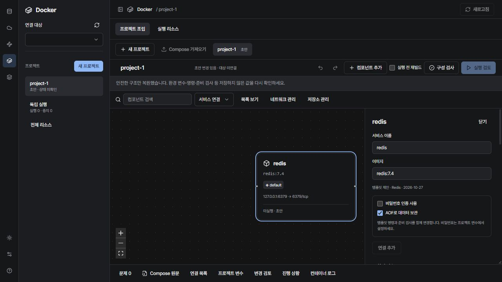

# Docker project builder verification

Branch: `codex/docker-project-builder` · 2026-10-27

## Implemented workflows

- Immediate engine-independent project drafts, safe structural restoration and connection-reference metadata.
- Bundled Redis 7.4, MySQL 8.4, PostgreSQL 16 and Elasticsearch 8.15.5 manifests; public Hub search/tags/platform/digest selection; existing local images and Dockerfiles.
- Service canvas and keyboard-accessible list, network/storage/startup layers, environment/port/mount/build/health/restart editing.
- Reviewed connection proposals, existing-value preservation, one-step undo, tracked rename/value changes and ownership-aware disconnect.
- Source-preserving YAML patches; aliases/anchors/include/extends and merged-file GUI edits restricted to source editing.
- Ordered multiple-file import, effective Compose review, source revision checks, `.env` additions reviewed with `.env.example` and `.gitignore` updates.
- Cancellable backend operations, bounded output, masked known values, metadata-only recovery records, exit/wait choice and runtime reconciliation.

## Executed checks

- `npm test`: **156 passed** (23 files) after final review fixes.
- `npm run build`: passed; existing large-chunk advisory remains.
- `cargo test --manifest-path src-tauri/Cargo.toml`: **108 passed**, 9 explicitly ignored integration tests. The two builder integration tests were then run explicitly and passed.
- Docker Playwright suite: **50 passed**, including 8 native-contract builder journeys and the small-window locale/theme cases.
- Browser checks use real React UI and mocked native IPC where required. They do not establish that the full installed desktop application's native dialogs were exercised.
- Small-window checks cover 960×640, Korean/English and light/dark, including keyboard activation of component addition.

## Real Docker verification

Environment: local `desktop-linux`, Docker Engine 29.8.2, Compose 5.5.1.

Command:

```text
cargo test --manifest-path src-tauri/Cargo.toml docker::builder::tests::native_review_run_recreate_and_data_retention -- --ignored --nocapture
```

Passed, including the normalized-model execution path and explicit rebuild. It creates a UUID-scoped `woojoo-builder-test-*` project and checks:

1. A changed `.env` invalidates the earlier review.
2. Execution consumes the reviewed model even if the original YAML is modified afterward.
3. Redis starts and becomes healthy.
4. A stored key survives service recreation.
5. A second service reaches Redis using service DNS and startup dependency.
6. An intentionally failed service is detected and can be corrected and restarted.
7. A Dockerfile builds a worker image, then changed local source is present after a reviewed `--build` run.
8. Only the test project's containers/network/volume and uniquely named build image are removed afterward.

`native_multifile_and_dotenv_roundtrip` also passed: merged references, effective baseline comparison, override image changes, and `.env` values containing backslashes, quotes, newlines and literal `$` round-trip through the real Compose CLI. No containers are needed for this second test.

Live read-only registry checks returned Docker search results (including official Redis metadata) and Hub tag/digest results. This does not certify every tag/platform combination or private registry authentication.

## Final review corrections

The independent whole-branch review found ten Important issues at commit `43fa8d4`. All were addressed in one correction pass; the reviewer was not asked to re-review. Final verification applies to the corrected code.

| Finding | Correction and evidence |
| --- | --- |
| Delayed reload could overwrite a different draft | Capture project/revision; discard stale completions. Browser regression switches projects before reload resolves. |
| Save completion could drop newer override edits | Advance disk baselines while retaining working buffers. Unit and delayed multi-file browser tests. |
| Pending review could approve old interpolation values | Invalidate review generation on variable changes. Delayed-review browser regression. |
| Reopened draft could target an old context | Synchronize selected drafts with the visible context. Browser regression switches context then reopens an older draft. |
| Alias protection bypassed by resource editing/rename | Check shared YAML ownership on every touched path and dependent service. Unit regressions. |
| Disconnect lost preexisting list-syntax env values | Semantic ownership snapshots restore prior values. Unit regression. |
| Multi-file checks/review used only first source | Defer merged references to Compose; show effective before/after services, ports, mounts, networks and startup. Browser and real CLI regressions. |
| Malformed raw leaves leaked into autosave | Runtime shape checks and an allowlist for persisted leaves. Secret-shaped malformed-input regression. |
| Destination selection disabled safe restoration | Pending destinations continue structural autosave until a save succeeds. Restoration regression. |
| Import ignored explicit Compose project identity | Honor the last explicit `name` in the ordered file set; use folder fallback only when absent. Unit regression. |

Additional corrections preserve range ports for source editing, require a port for unknown images, support shorthand build arguments, restore replaced startup conditions, fix dotenv escaping, cover stdin with cancellation/timeouts, and stage multi-file saves with guarded restoration after a failed replacement. An injected second-file failure verifies restoration and staging cleanup. This is not a claim of crash-atomic multi-file transactions.

The source was formatted and asynchronous completion logic extracted into named helpers. No review findings were intentionally left unfixed. Execution review now shows masked structural changes and an explicit rebuild choice; the Docker sidebar includes draft/file projects and runtime-only projects.

No test project containers remained after cleanup. The downloaded Redis image is retained as a reusable local cache.

## Boundaries shown in the product

- Static/config validation does not prove image existence, application variable consumption, reachability or readiness.
- Imported multi-file effective views are read-only; edit the original file tabs.
- Unclassified environment values, commands, build arguments and unsaved raw YAML are excluded from automatic restoration.
- Imported raw files remain in their original locations. Explicit source saves may contain plaintext secrets.
- Build contexts and bind/config/secret file contents remain external inputs; the application does not freeze the full build tree.
- Cancellation stops owned CLI processes. Docker daemon work may continue; the result is marked unknown and reconciled, not automatically replayed.
- Elasticsearch's pinned compatibility template is explicitly labeled unmaintained and does not disable authentication/TLS.
- Full installed-desktop native-dialog timing, real app termination/restart during a running CLI operation, and every keyboard-only route still require manual release validation. Browser/native-contract tests and recovery serialization tests cover their constituent paths, not that complete installed-app scenario.
- Safe structural metadata uses WebView local storage; runtime operation records use native app-data storage. Source and secret values are excluded from automatic metadata persistence.


